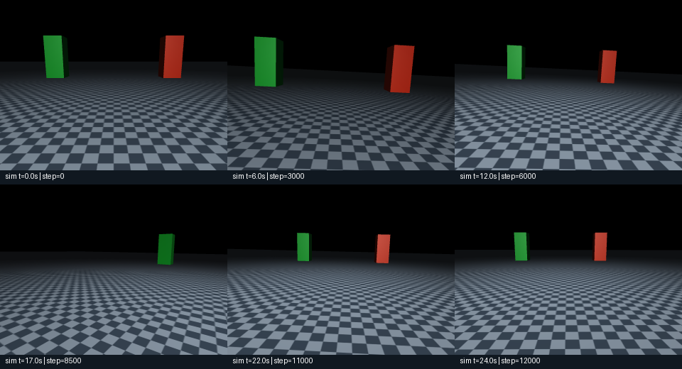
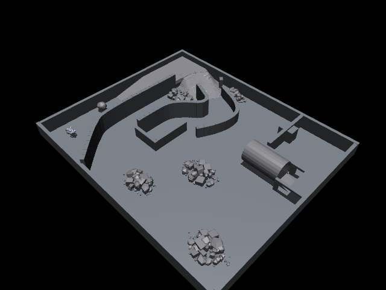
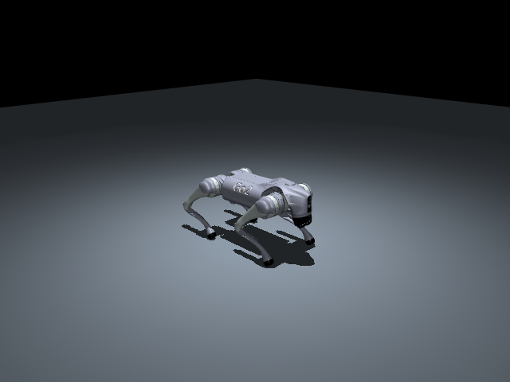

# 废墟智援 · MuJoCo 基础仿真

Ubuntu 本机开发，Python 3.12 + MuJoCo 3.17.0。基础目标是公开模型和赛场的加载、重置、原地站立、物理步进与画面渲染。已实现本地平地手写基础步态与操控反馈，尚无完赛策略或训练模型。

仓库：https://github.com/chenpeteryu/ruins-aid-mujoco （私有）

## 当前进度

2026-11-16：本机环境搭建及基础仿真通过。RTX 4080 Laptop 12 GB、NVIDIA 580.178.04 可用，EGL 渲染和桌面查看器已验证。完整结果见 [进度记录](docs/进度.md)。

## 操控、运动与相机记录

```bash
# 点击窗口后 ↑/↓ 前后、←/→ 转向、空格停止、Q 结束
.venv/bin/python 代码/control_feedback.py --mode keyboard

# 资源包完整公开赛场中的键盘操控
.venv/bin/python 代码/control_feedback.py --scene course --mode keyboard

# 自动动作与同步记录（默认平地）
MUJOCO_GL=egl .venv/bin/python 代码/control_feedback.py --mode demo
```

键盘模式同时打开操控和相机画面两个窗口，初始朝向默认左转 90°（可用 `--yaw-deg 0` 恢复）。

50Hz 反馈、10Hz 前视 RGB 按仿真时间戳保存到 `输出/操控反馈/`。详见 [操控与传感器](docs/操控与传感器.md)，包括接口、数据格式、已验证结果与限制。



## 本机运行

在项目根目录：

```bash
# 无窗口，验证模型、站立、重置及物理步进
.venv/bin/python 代码/inspect_models.py
.venv/bin/python 代码/basic_sim.py --scene flat
.venv/bin/python 代码/basic_sim.py --scene course

# GPU 离屏渲染，保存 PNG、GIF、轨迹和 JSON
MUJOCO_GL=egl .venv/bin/python 代码/basic_sim.py --scene course --render

# 打开桌面窗口；默认运行 5 秒后自动关闭，可调整时长
.venv/bin/python 代码/basic_sim.py --scene course --viewer --seconds 30
```

本地 Python 位于 `.tools/bin/python3.12`，系统 Python 3.10 保持不变。仿真使用 `.venv/bin/python`。

## 另一台设备复现

1. 克隆本私有仓库，安装 Python 3.12。
2. 从有权限的赛事资料来源取得 `training-package-v8.zip`，按 [资源说明](docs/资源与环境.md) 校验后解压。
3. 执行 `bash scripts/setup.sh` 安装锁定依赖；若使用当前项目自带 Python，可设置 `PYTHON_BIN=.tools/bin/python3.12`。
4. 执行上面的无窗口命令，再按设备条件验证 EGL 或桌面渲染。

基础物理仿真不要求 NVIDIA GPU。图形渲染需要设备可用的 OpenGL/EGL 库；当前验证平台为 Ubuntu，其他系统需单独验证。无需 ROS、Docker、CUDA Toolkit 或单独下载 MuJoCo GUI。

## 结果与目录

- `代码/`：资源校验、模型检查和基础站立仿真。
- `requirements-lock.txt`：本次实际安装的完整依赖版本；`requirements.txt`：直接依赖。
- `docs/`：环境说明、已知问题和下一步思路。
- `输出/仿真/`：本次运行结果；小型 JSON、CSV、PNG 随仓库同步，GIF 仅本地保存。
- `资源/`、`文档/原始资料/`、`视频/`：本地原始资料，不纳入 Git。
- `检查记录/`：历史环境记录；其中 11 月 14 日的 Docker 建议已由当前本机方案替代。

原始工作区的 `.git` 是只读占位目录，因此本机通过 `bash scripts/git-local.sh status`、`... add`、`... commit`、`... push` 操作 `.sync-repo`。其他设备正常克隆后直接使用普通 Git 命令。

## 基础结果





这里展示的是公开训练场景与基础 PD 站立。当前新增了平地基础运动和本地传感器反馈验证；正式传感器合同、复杂地形避障、ONNX 与平台提交尚未完成。
